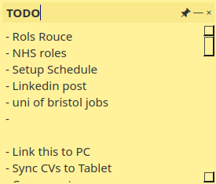
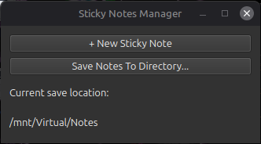

   

# Sticky 📝📌

A lightweight desktop notes application built with C++ and Qt 6, designed primarily for Ubuntu

## Features
- create and manage multiple sticky notes simultaneously
- saved as seperate .md files.
- custom save location
- pin notes to stay on top

## Building

### Requirements
- C++ compiler with C++17 support
- Qt 6 Widgets development libraries
- pkg-config

Clone the repository:
```
git clone https://github.com/ByCubed7sLaptop/Sticky.git
cd Sticky
```

Install requirements via:
```
sudo apt install build-essential g++ pkg-config qt6-base-dev
```


Run build script:
```
chmod +x build.sh
./build.sh
```
This will be compiled at: `build/sticky`


## Running
Launch Sticky using:
```
./build/sticky
```
